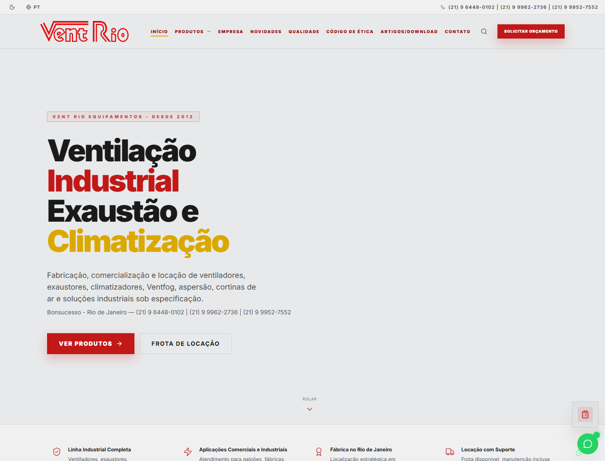
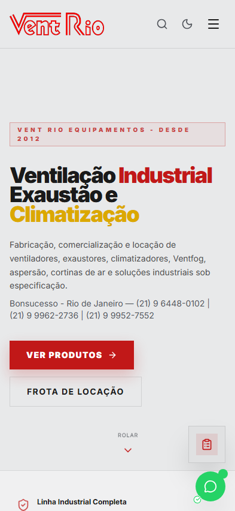
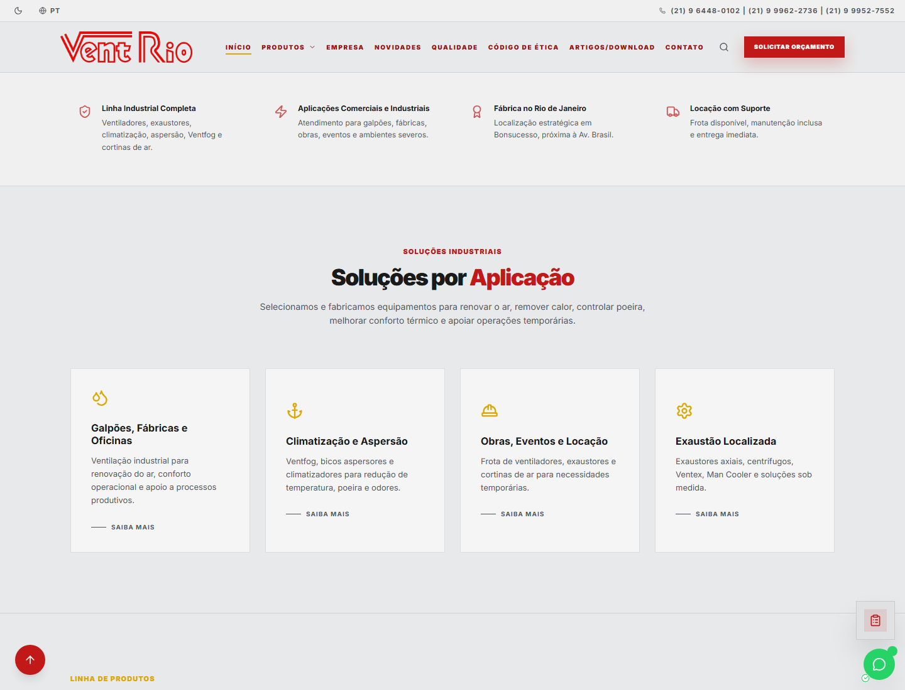
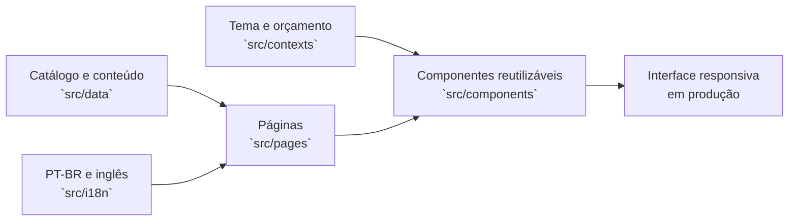

# Vent Rio Equipamentos — site institucional

> Versão pública do site que desenvolvi para apresentar a linha industrial de ventilação, exaustão, climatização e locação da Vent Rio Equipamentos.

[](https://www.ventrio.ind.br/)
[](#stack)
[](docs/portfolio-release.md)

**[Case no portfólio](https://mayconxzdev.github.io/projetos/sites-industriais/)** · **[Ver site online](https://www.ventrio.ind.br/)** · **[Detalhes do projeto](docs/case-study.md)** · **[Roteiro de uso](docs/demo-walkthrough.md)** · **[Segurança](SECURITY.md)**



## Visão geral

Desenvolvi o design e a interface do site institucional da Vent Rio Equipamentos. A proposta foi organizar um portfólio amplo — ventiladores, exaustores, climatização, aspersão, cortinas de ar e locação — em uma navegação clara para públicos comerciais e industriais.

| Aspecto | Situação atual |
|---|---|
| **Site publicado** | [ventrio.ind.br](https://www.ventrio.ind.br/) |
| **Minha atuação** | Direção visual, experiência responsiva, organização de conteúdo, implementação front-end, deploy, domínio e manutenção |
| **Estrutura** | 13 páginas, 11 componentes reutilizáveis, catálogo separado da interface e traduções PT-BR/EN |
| **Qualidade** | GitHub Actions com lint, validação da cópia pública e build |
| **Versão pública** | Sem credenciais, dados de lead ou integrações operacionais da empresa |

## O que desenvolvi

- direção visual e construção da experiência institucional;
- design responsivo para desktop e mobile;
- organização de conteúdo comercial, técnico, de locação e institucional;
- componentes reutilizáveis para navegação, produtos, especificações, busca e lista de orçamento;
- catálogo orientado por dados e estrutura de tradução PT-BR/inglês;
- estados de interface, feedback de interação e caminhos de contato contextualizados;
- deploy, configuração de domínio e manutenção contínua.

No ambiente de produção, o formulário utiliza backend em **Python**, envio por **SMTP** e integração com **CRM**. Esses componentes, credenciais e configurações de infraestrutura foram removidos da edição pública para proteger o fluxo de leads e o ambiente da empresa.

## Interface publicada

| Desktop | Mobile | Catálogo e aplicações |
|---|---|---|
|  |  |  |

As capturas foram feitas no site público em **28 de julho de 2026**, sem criar contatos ou enviar formulários.

## Decisões de experiência

1. **Catálogo sem sobrecarga.** A home apresenta famílias de uso antes de pedir a escolha de um produto específico.
2. **Aplicação como ponto de entrada.** Galpões, obras, eventos, climatização e exaustão localizada funcionam como atalhos para quem não conhece o catálogo.
3. **Ritmo de leitura comercial.** Benefícios, linhas, locação e atendimento seguem uma ordem que ajuda a entender a oferta antes de solicitar orçamento.
4. **Componentes reutilizáveis.** Produtos, especificações e categorias ficam separados da camada visual.
5. **Experiência mobile.** Os caminhos essenciais continuam disponíveis sem depender de hover.

## Arquitetura da interface



## Stack

- React 18 e Vite
- Tailwind CSS e PostCSS
- i18next / react-i18next
- Lucide React
- ESLint

## Estrutura

```text
src/
├── components/     componentes de interface e produto
├── contexts/       tema e lista de orçamento
├── data/           catálogo, especificações e conteúdo institucional
├── i18n/           traduções PT-BR e inglês
├── pages/          páginas e fluxos de navegação
└── utils/          eventos de interface e inteligência de produto
```

## Executar localmente

```powershell
npm ci
npm run dev
```

```powershell
npm run lint
npm run test:portfolio
npm run build
```

## Estado e limites

Esta é uma cópia pública preparada para mostrar a interface e a organização do projeto. Integrações de e-mail, bibliotecas de transporte, FTP e referências de infraestrutura foram removidas. O formulário desta edição exibe apenas um retorno de demonstração e não envia leads para a empresa.

Marca, conteúdo e ativos da Vent Rio permanecem sujeitos aos respectivos direitos. Consulte [docs/portfolio-release.md](docs/portfolio-release.md) antes de reutilizar o projeto.

## Autor

**Maycon Ferreira** — design, implementação, deploy e manutenção da experiência de interface.

<https://github.com/Mayconxzdev>
