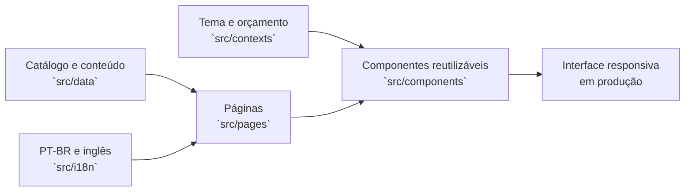

# Vent Rio Equipamentos — site institucional

> Estudo de caso público do site da Vent Rio Equipamentos, criado para apresentar uma linha industrial de ventilação, exaustão, climatização e locação.

[](https://www.ventrio.ind.br/)
[](#stack)
[](docs/portfolio-release.md)

**[Ver site online](https://www.ventrio.ind.br/)** · **[Ler estudo de caso](docs/case-study.md)** · **[Roteiro de demonstração](docs/demo-walkthrough.md)** · **[Notas de segurança](SECURITY.md)**


## Leitura rápida para recrutadores

| Em menos de dois minutos | Evidência disponível |
| --- | --- |
| **Entrega real** | [Site institucional em produção](https://www.ventrio.ind.br/) e capturas feitas diretamente nele. |
| **Minha responsabilidade** | Design da interface, experiência responsiva, organização de conteúdo e implementação front-end. |
| **Escala da interface** | 13 páginas, 11 componentes reutilizáveis, dados de catálogo separados e traduções PT-BR/EN. |
| **Qualidade verificável** | GitHub Actions executa lint, validação do recorte público e build em todo push. |
| **Limite honesto** | Sem métricas inventadas e sem integrações operacionais, credenciais ou dados de lead nesta cópia. |

Para uma avaliação guiada, siga o [roteiro de demonstração](docs/demo-walkthrough.md).

## O projeto

Eu desenvolvi o design e a experiência de interface do site institucional da Vent Rio Equipamentos. A proposta foi transformar um portfólio amplo — ventiladores, exaustores, climatização, aspersão, cortinas de ar e locação — em uma navegação clara para públicos comerciais e industriais.

O site em produção organiza aplicações, categorias, produtos, suporte e contato numa experiência responsiva. Ele está publicado em [ventrio.ind.br](https://www.ventrio.ind.br/).

## Minha atuação

- Direção visual e construção da experiência institucional.
- Design responsivo para desktop e mobile.
- Organização do conteúdo comercial, técnico, de locação e institucional.
- Componentes reutilizáveis para navegação, produtos, especificações, busca e lista de orçamento.
- Catálogo orientado por dados e estrutura de tradução PT-BR/inglês.
- Estados de interface, feedback de interação e caminhos de contato contextualizados.

  ### Operação e integrações em produção

Além da interface, fui responsável pelo deploy, configuração do domínio e manutenção contínua do site.

No ambiente de produção, o formulário utiliza um backend em **Python**, envio por **SMTP** e integração com **CRM**. Esses componentes, credenciais e configurações de infraestrutura foram removidos da edição pública para proteger o fluxo de leads e o ambiente da empresa.

## Evidências da entrega publicada

| Desktop | Mobile | Catálogo e aplicações |
| --- | --- | --- |
|  |  |  |

As capturas foram feitas no site público em **28 de julho de 2026**, sem criar contatos ou enviar formulários.

## Decisões de experiência

1. **Catálogo sem sobrecarga.** A home apresenta famílias de uso antes de pedir a seleção de um produto específico.
2. **Aplicação como ponto de entrada.** Galpões, obras, eventos, climatização e exaustão localizada funcionam como atalhos compreensíveis para quem não conhece o catálogo.
3. **Ritmo de leitura comercial.** Benefícios, linhas, locação e processo de atendimento seguem uma ordem que ajuda a pessoa a entender a oferta antes de solicitar orçamento.
4. **Componentes que escalam.** Produtos, especificações e categorias ficam separados da camada visual para permitir evolução do catálogo.
5. **Experiência adaptada.** Os caminhos essenciais continuam disponíveis em telas mobile, sem depender de interação por hover.

Mais contexto está em [docs/case-study.md](docs/case-study.md).

## Arquitetura da interface



## Stack

- React 18 e Vite
- Tailwind CSS e PostCSS
- i18next / react-i18next para localização
- Lucide React para iconografia
- ESLint para qualidade estática

## Estrutura relevante

```text
src/
├── components/     componentes de interface e produto
├── contexts/       tema e lista de orçamento
├── data/           catálogo, especificações e conteúdo institucional
├── i18n/           traduções PT-BR e inglês
├── pages/          páginas e fluxos de navegação
└── utils/          eventos de interface e inteligência de produto
```

## Executar localmente

```powershell
npm ci
npm run dev
```

Validações disponíveis:

```powershell
npm run lint
npm run test:portfolio
npm run build
```

## Escopo desta cópia pública

Este repositório é uma versão preparada para portfólio. A interface, os componentes e o catálogo público foram preservados; integrações operacionais de e-mail, bibliotecas de transporte, configuração de FTP e referências de infraestrutura foram removidas intencionalmente.

O formulário desta cópia exibe um retorno de demonstração e **não envia leads para a empresa**. O site em produção possui sua própria operação de contato.

Leia [docs/portfolio-release.md](docs/portfolio-release.md) antes de reutilizar o projeto. Marca, conteúdo e ativos da Vent Rio permanecem sujeitos aos seus respectivos direitos.

## Autor

**Maycon Ferreira** — design e implementação da experiência de interface.

<https://github.com/Mayconxzdev>
